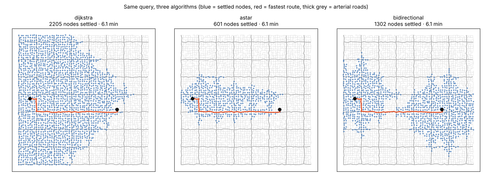

# algorithm-route-planner

Fastest-route search on a road network, implemented three ways (Dijkstra, A*, bidirectional Dijkstra) and benchmarked on the same queries, to measure how much work each one saves.



## Problem

A navigation app answers "what is the fastest way from A to B" millions of times a day. Plain Dijkstra answers it correctly, but it explores outward in every direction, including directly away from the destination. The two classic fixes are:

- **A\*** steers the search toward the destination using an estimate of the remaining time.
- **Bidirectional search** runs one search from each end and stops when they meet.

Both must return exactly the same answer as Dijkstra, and both have correctness conditions that are easy to get wrong. This project implements all three, checks they always agree, and measures how much work each saves on a road network with one-way streets and fast arterial roads.

## Overview

- `route_planner/search.py`: the three algorithms. Each returns the travel time, the route and the number of nodes it settled.
- `route_planner/generate.py`: a deterministic synthetic city:
  - a jittered street grid;
  - curvy roads, each 0–25% longer than the straight line;
  - missing blocks;
  - 15% one-way streets;
  - an arterial road every 8 blocks.
- `route_planner/bench.py`: runs every algorithm on the same random queries. It **fails if any two algorithms disagree** on a travel time, so every benchmark is also a correctness check.
- `route_planner/plot.py`: draws which nodes each algorithm settled (the image above).
- `route_planner/cli.py`: `generate`, `route`, `bench` and `plot` commands.

## Key features

- Directed graph: one-way streets are respected. The backward search runs on a separately stored reversed graph.
- Edge weights are travel times, so the fastest route can differ from the shortest.
- A\* uses an admissible, consistent heuristic: straight-line distance divided by the fastest speed in the graph.
- Bidirectional Dijkstra uses the correct stopping rule (see below), not "stop when the searches first touch".
- Plain-text graph file format with validated loading and line-numbered error messages.
- No runtime dependencies. Plotting needs matplotlib.

## Tech stack

- Python 3.11+ (tested on 3.11, 3.12 and 3.13), standard library only (`heapq`, `dataclasses`, `argparse`)
- pytest for tests
- matplotlib (optional) for the visualization

## Architecture

```
route_planner/
├── graph.py      Graph: coordinates, adjacency list + reversed adjacency, file I/O
├── search.py     dijkstra, astar, bidirectional_dijkstra -> SearchResult
├── generate.py   generate_city(size, seed, arterial_kmh) -> Graph
├── bench.py      run_benchmark: same queries for every algorithm, cross-checks costs
├── plot.py       plot_search_areas: settled nodes per algorithm
└── cli.py        command-line entry point (python -m route_planner)
```

**Priority queue.** Python's `heapq` has no decrease-key operation. Instead, when a node's distance improves, a new entry is pushed; stale entries are skipped when popped, using a `done` set. This is "lazy deletion". It's simpler than an indexed heap and costs O(E log E) instead of O(E log V), which is effectively the same for road graphs.

**Dijkstra is A\* with h = 0.** `dijkstra()` calls `astar()` with a zero heuristic, so the two can't drift apart. Any difference in their work comes only from the heuristic.

**The A\* heuristic.** `h(u) = straight_line(u, target) / max_speed`. Every road is at least as long as the straight line between its ends, and no road is faster than `max_speed`. So `h` never overestimates the remaining time (admissible), and A\* returns the optimal route. It is also consistent: `h(u) ≤ time(u→v) + h(v)` for every edge. That's why each node is settled at most once, and why the lazy-deletion skip is valid for A\* too.

**Bidirectional stopping rule.** The forward search runs from the source and the backward search from the target on reversed edges. Whenever a relaxed edge reaches a node the other side has labelled, the combined cost is a candidate route. Let `best` be the cheapest candidate so far. The search may stop only when

```
top_of_forward_queue + top_of_backward_queue >= best
```

Any route not yet seen must leave the forward frontier and enter the backward one, so it costs at least that sum. Stopping as soon as the searches first meet is a common bug: it can return a slower route. The test suite catches exactly that bug.

## Installation

```bash
git clone https://github.com/AhmadElAmeer/algorithm-route-planner.git
cd algorithm-route-planner
python3 -m pip install -e ".[plot,test]"   # or just: pip install pytest matplotlib
```

## Usage

```bash
# generate a 150 x 150 city (22,500 intersections, ~75,000 one-way road segments)
python3 -m route_planner generate --size 150 --seed 7 -o data/city-150.graph

# fastest route between two intersections
python3 -m route_planner route data/city-150.graph 1805 16545 --algo astar
#   travel time: 18.13 min over 146 road segments
#   nodes settled by astar: 6808

# compare all three algorithms on 300 random queries
python3 -m route_planner bench data/city-150.graph --queries 300

# draw what each algorithm explored for one query
python3 -m route_planner plot data/city-150.graph 1805 16545 -o search.png

# how arterial-road speed affects each algorithm
python3 scripts/speed_sweep.py
```

The image at the top was produced with `generate --size 60 --seed 4` and `plot ... 1805 1545`.

Graph file format:

```
n <id> <x_m> <y_m>                      # intersections, ids 0, 1, 2, ... in order
e <from> <to> <length_m> <speed_kmh>    # one-way road segment
```

## Results

`bench` on the 150 × 150 city (seed 7), 300 random queries, on a 2-core Intel Xeon @ 2.10 GHz with Python 3.13:

```
22500 nodes, 75089 edges, 300 random queries (0 unreachable); all algorithms agreed on every travel time

algorithm        mean settled     vs dijkstra   median ms
dijkstra                11605           1.00x       19.25
astar                    4398           0.38x        5.71
bidirectional            7503           0.65x       13.27
```

*Settled-node counts are deterministic. Median times varied by about 5% between repeated runs.*

`scripts/speed_sweep.py` shows the same city with the arterial speed changed (streets stay at 30 km/h):

```
 arterial km/h  astar vs dijkstra  bidir vs dijkstra
            30              0.32x              0.69x
            50              0.38x              0.67x
            70              0.38x              0.65x
           100              0.38x              0.61x
           130              0.38x              0.59x
```

What the numbers show:

- **A\* did the least work**, settling about 38% of the nodes Dijkstra settled on the default city, and running about 3.4× faster.
- **Fast roads weaken A\*.** When every road has the same speed, A\* settles 32% of Dijkstra's nodes. Once arterials are faster than streets, the heuristic has to assume the whole remaining trip is at arterial speed, which underestimates most trips. A\* rose to 38% and stayed there as arterial speed increased further. That plateau is an observation from this generator, not a general law.
- **Bidirectional search gets better as arterials get faster** (0.69× → 0.59×). The two search "balls" only have to reach a fast road and meet in the middle. It still did more work than A\* on every setting tried.

## Testing

```bash
python3 -m pytest -q        # 68 tests
```

- **Against a reference:** on 25 random directed graphs with parallel edges, self-loops and unreachable pairs, every algorithm's answer for **every source–target pair** is compared with Floyd–Warshall. That reference is a deliberately different O(n³) algorithm. The returned route is also re-costed edge by edge to confirm it matches the reported travel time.
- **Behaviour:** faster route over fewer edges, one-way streets, source equals target, invalid nodes, heuristic admissibility checked against true distances, and each node settled at most once.
- **A negative example:** an overestimating heuristic makes A\* return a slower route. This shows in a test why admissibility matters.
- **File format:** save/load round trip, plus six kinds of malformed files.
- **CLI:** every command, including error exits and the PNG output.

To check that the tests can fail, six bugs were planted one at a time:

- bidirectional search stops at the first meeting;
- an inadmissible heuristic;
- the backward search ignores one-way streets;
- the meeting node is duplicated in the route;
- speeds aren't converted from km/h on load;
- stale heap entries aren't skipped.

All six were caught. The last one only wastes work without changing any answer. It got through the first version of the suite, which is why the "settled at most once" test exists.

## Design decisions and challenges

- **Synthetic data instead of a real map.** Real OpenStreetMap data needs a download and a parser, and its size makes tests slow. The generator keeps the properties that affect these algorithms (one-way streets, road curvature, fast arterials) and is reproducible from a seed. The plain-text format means a real extract could be converted and loaded later.
- **Keeping the heuristic admissible after rounding.** Coordinates and lengths are saved with 3 decimals. A perfectly straight road could therefore load as 1 mm "shorter" than the straight line between its rounded endpoints, making the heuristic overestimate slightly. The first benchmark run hit exactly this. The loader now clamps differences under 1 cm to the straight-line length and still rejects anything larger.
- **Measuring work, not just time.** Wall-clock time depends on the machine and on Python overhead. Settled-node counts are deterministic and measure what the algorithm decided to do, so they are the main metric. Time is reported as a sanity check.
- **One implementation for Dijkstra and A\*.** It guarantees the comparison measures only the heuristic.

## Future improvements

- **ALT (A\*, Landmarks, Triangle inequality):** precompute distances to a few landmarks for a much tighter heuristic. This directly addresses the arterial-road weakness measured above.
- Bidirectional A\* with a consistent potential function.
- **Contraction hierarchies:** the preprocessing technique real routing engines use for millisecond queries on continent-sized maps.
- Import an OpenStreetMap extract and repeat the benchmark on a real city.
- An indexed binary heap with decrease-key, to compare against lazy deletion.

## What this project teaches

- How Dijkstra works, and why its priority queue settles nodes in order of distance.
- Heuristic search: admissibility and consistency, and what breaks without them.
- Why bidirectional search needs a careful stopping rule.
- Graph representation for directed graphs, including keeping a reversed graph.
- Testing algorithms against a simple brute-force reference, and benchmarking with a deterministic metric.

## License

MIT — see [LICENSE](LICENSE).
